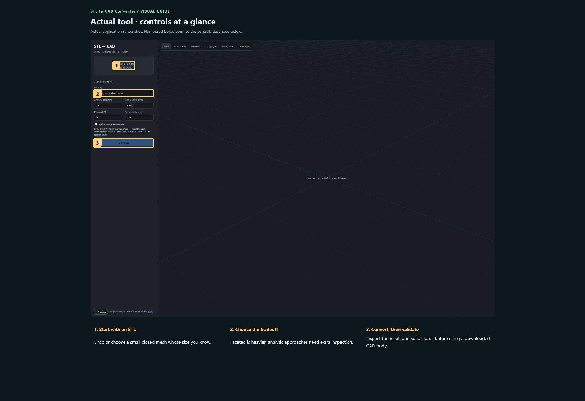
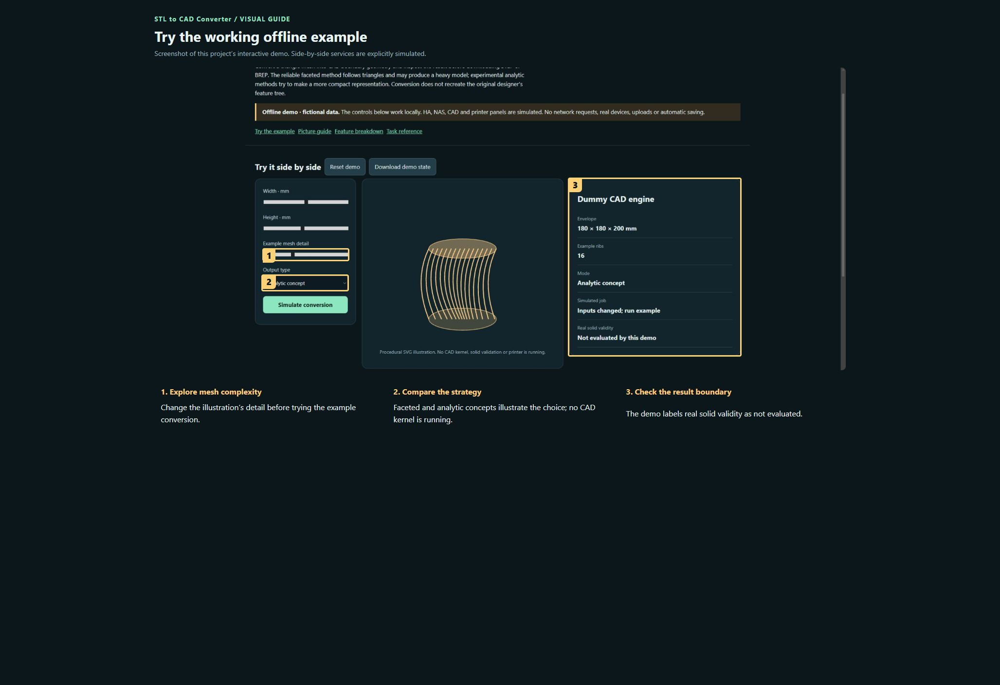

# STL to CAD Converter

Convert a triangle mesh into CAD boundary geometry and inspect the result before downloading STEP or BREP. The reliable faceted method follows triangles and may produce a heavy model; experimental analytic methods try to make a more compact representation. Conversion does not recreate the original designer’s feature tree.

**Private preview · not published.**

[Open the visual manual](docs/USER-MANUAL.md) · [Download the self-contained demo](demo.html) · [Release notes](CHANGELOG.md)

Download `demo.html` using GitHub’s Download raw file control, then open it in your browser. GitHub displays HTML source; it does not run the demo on this page. The demo is an offline simulation with fictional data and makes no network requests.

## See it

### Actual tool · controls at a glance

Actual application screenshot. Numbered boxes point to the controls described below. 

1. **Start with an STL.** Drop or choose a small closed mesh whose size you know.
2. **Choose the tradeoff.** Faceted is heavier; analytic approaches need extra inspection.
3. **Convert, then validate.** Inspect the result and solid status before using a downloaded CAD body.

### Try the working offline example

Screenshot of this project’s interactive demo. Side-by-side services are explicitly simulated.

1. **Explore mesh complexity.** Change the illustration’s detail before trying the example conversion.
2. **Compare the strategy.** Faceted and analytic concepts illustrate the choice; no CAD kernel is running.
3. **Check the result boundary.** The demo labels real solid validity as not evaluated.

## What this tool does

| Feature | What it lets you do | Where |
| --- | --- | --- |
| Mesh input | Upload an STL; the hosted route enforces a 32 MB limit. | Conversion workflow |
| Method selection | Faceted, arcwise and hybrid strategies with different fidelity, size and robustness tradeoffs. | Conversion workflow |
| Controls | Analytic tolerance, decimation target, dihedral threshold, arc simplification and refinement. | Conversion workflow |
| Inspection | Solid, Input mesh, Deviation, By type and Wireframe views. | Conversion workflow |
| Validation | Review closure, solid count, volume/deviation information and timings when available. | Conversion workflow |
| Downloads | Export STEP, BREP and result archives for downstream CAD work. | Conversion workflow |

## A first useful workflow

### Convert a first part

1. Start with a small, closed STL whose scale you know. Keep the original unchanged.
2. Upload the STL, choose faceted as the baseline and inspect the triangle target. Decimation changes the mesh used for subsequent work, so document that choice.
3. Choose Convert and wait for the job result. Do not treat an output file alone as proof of a closed solid.
4. Read the validation result: closure, solid count, dimensions, volume and deviation. Inspect holes and thin features visually.

## Saving and outputs

Treat conversion jobs as temporary working results and download the outputs you need. The source repository does not contain uploaded meshes or the NAS job store. Back up original meshes independently.

## Running the actual tool

Follow the source environment setup, then run python -m webapp.

The demo has no prerequisites; the real tool may need the services described in the manual and retained source notes.

## Current boundaries

A local static server cannot perform CAD conversion. The package needs the configured OpenCascade/Python environment or the NAS conversion service. No new full CAD integration test was performed for this documentation update.

## Licence and sharing

MIT applies to original project contributions. Bundled/upstream software and assets retain their own terms; see [third-party notes](THIRD-PARTY.md). Keep this repository private until its own [release checklist](RELEASE-CHECKLIST.md) is complete and the owner authorises publication.
